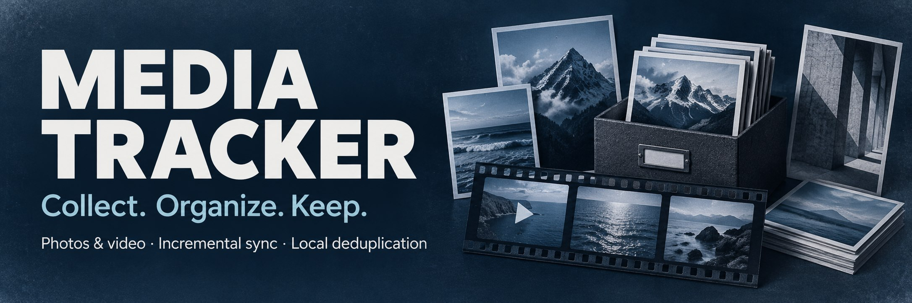
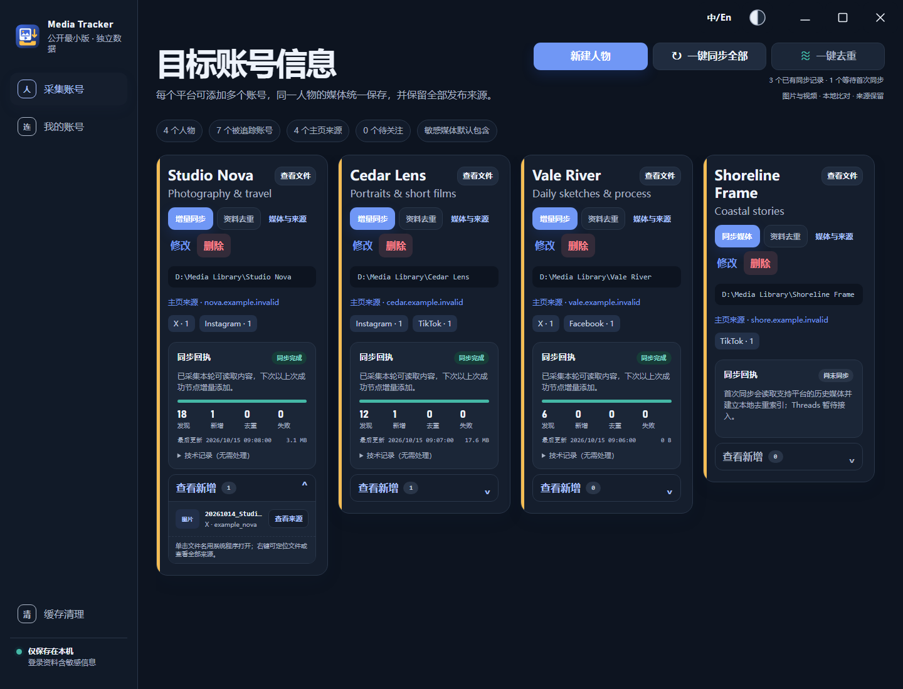
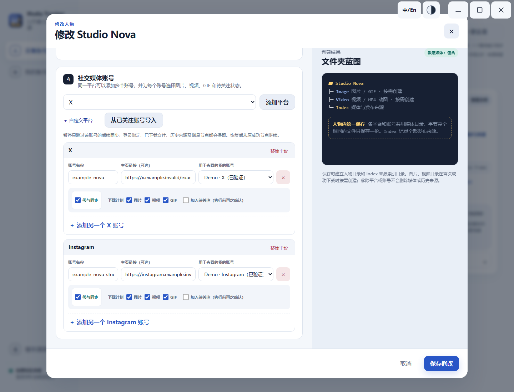
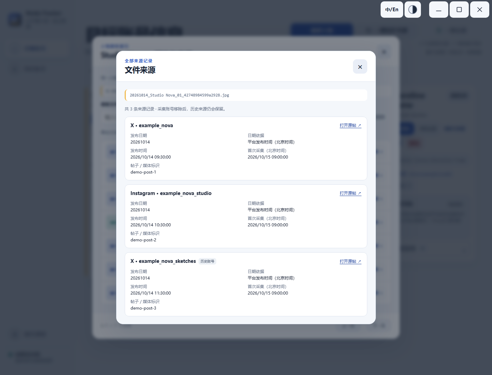

[简体中文](README.md) · [English](README.en.md)

# Media Tracker · 采集工具

面向 Windows 的本地媒体采集与管理工具，将关注博主的照片、视频集中保存，便于持续整理与查找。

## 产品亮点

- **集中收藏**：按人物归集 X、Instagram、Facebook、TikTok 等平台当前可访问的照片与视频。
- **增量同步**：首次采集后持续添加新内容，已保存媒体不会因原帖删除而自动删除。
- **本地去重**：内置精确去重，可按需启用图片、视频相似去重，无需上传媒体。
- **来源可查**：统一管理多个平台、多个账号，保留发布来源，支持搜索、打开及定位文件。

## 产品简介

同一人物的媒体统一保存至 `Image`、`Video`，发布来源记录在 `Index`。支持 Windows 10/11 x64，提供中英文界面，以及深色、浅色和跟随系统主题。

## 快速上手

1. 到[下载页面](https://github.com/cavwic/media-tracker-windows/releases/latest)下载软件 ZIP，完整解压；不要选 `Source code`。
2. 首次运行 `首次编译.cmd`，按提示确认准备运行环境。完成后，以后直接打开 `采集工具.exe`。
3. 在“我的账号”登录并验证，点“新建人物”，添加目标账号和保存目录，再点“同步媒体”。以后用“增量同步”或“一键同步全部”即可。

需要相似去重时，按提示下载组件或选择已有工具；暂不准备也能正常采集和精确去重。无需管理员权限，不修改注册表；移动软件时请保留整个文件夹。

## 界面预览

以下为实际界面的虚构演示数据，不代表真实平台下载结果，不含真实账号、登录资料或采集媒体。点击图片可查看大图。

**账号总览**：按人物查看平台账号、同步状态和新增文件。

**采集设置**：为同一人物添加多个平台账号，选择要同步的内容，统一保存媒体和来源。

**来源追溯**：查看同一文件关联的发布平台、账号和原帖。

---

本工具未获平台自动采集许可，请遵守平台规则及内容权利。EXE 未签名，Windows 可能显示安全提示；相似去重可能误判，重要媒体请先备份。

[隐私](PRIVACY.md) · [许可证](LICENSE) · [使用边界](PUBLIC-EDITION.md) · [开发与贡献](CONTRIBUTING.md) · [反馈](https://github.com/cavwic/media-tracker-windows/issues/new/choose) · [安全问题](SECURITY.md)
