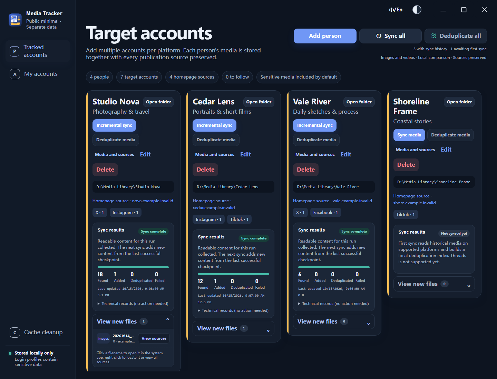
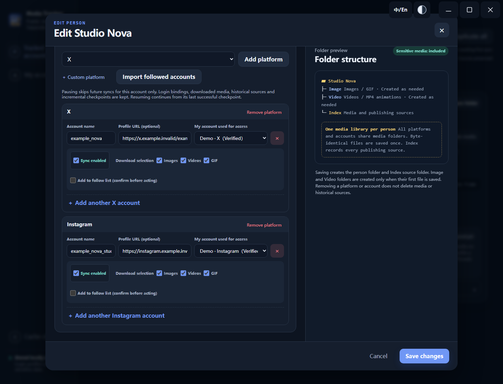
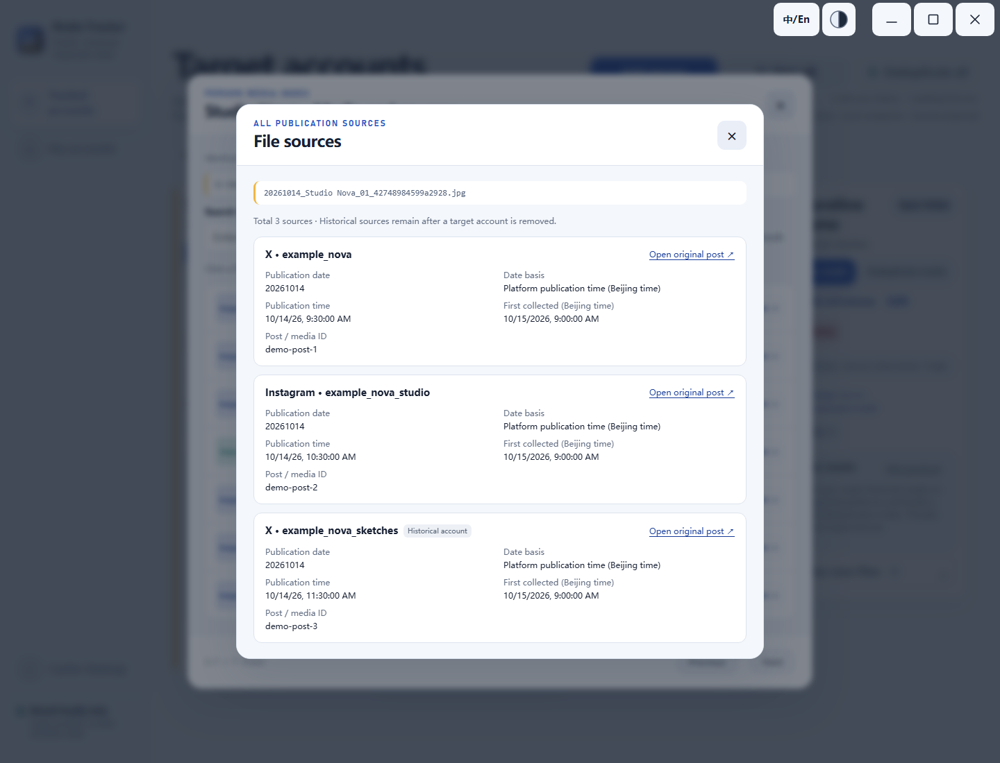

[简体中文](../README.md#user-content-readme-zh) · [English](../README.md#user-content-readme-en)

# Media Tracker

**Collect. Organize. Keep.**

Photos & video · Incremental sync · Local deduplication

A local media collection and management tool for Windows. Keep photos and videos from creators you follow in one place, ready to organize and find.

## Highlights

- **Collect in one place**: Save currently accessible photos and videos from X, Instagram, Facebook, TikTok, and other supported platforms.
- **Incremental sync**: Add new media after the initial collection. Saved files are not automatically deleted when the original post disappears.
- **Local deduplication**: Remove exact duplicates, with optional similarity checks for images and videos. Media stays on your computer.
- **Traceable sources**: Group multiple platforms and accounts by person, retain publishing sources, and search, open, or locate saved files.

## Overview

Each person's media is organized into `Image` and `Video` folders, with publishing sources recorded in `Index`. Supports Windows 10/11 x64, Chinese and English interfaces, and light, dark, or system themes.

## Quick start

1. Get the application ZIP from the [download page](https://github.com/cavwic/media-tracker-windows/releases/latest) and extract the whole folder. Don't choose `Source code`.
2. Run `首次编译.cmd` once and confirm the runtime setup when prompted. After that, open `采集工具.exe` directly.
3. Sign in and verify the required platforms under **My accounts**. Choose **Add person**, add target accounts and a save location, then click **Sync media**. Next time, use **Incremental sync** or **Sync all**.

For similarity checks, download the optional tools when prompted or select tools you already have. Collection and exact deduplication work without them. No administrator access or registry changes are required. Keep the whole folder together when moving the app.

## Interface preview

These are actual interface screenshots with fictional demo data, not evidence of real platform downloads. They contain no real accounts, login information, or collected media. Click an image for a larger view.

**Account overview**: View grouped platform accounts, sync status, and newly saved files.

**Collection setup**: Add multiple target accounts, choose what to sync, and keep each person's media and source records together.

**Source tracking**: View the platforms, accounts, and original posts associated with a saved file.

---

This tool has not received platform authorization for automated collection. Follow platform rules and respect content rights. The EXE is unsigned, so Windows may display a security warning. Similarity checks can misidentify duplicates; back up important media first.

[Privacy](PRIVACY.md) · [License](../LICENSE) · [Usage boundaries](PUBLIC-EDITION.md) · [Contributing](../.github/CONTRIBUTING.md) · [Feedback](https://github.com/cavwic/media-tracker-windows/issues/new/choose) · [Security](../.github/SECURITY.md)
